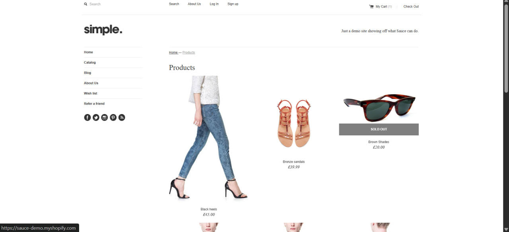

# BUG-01: [UI] Нарушено выравнивание карточек товаров в сетке каталога на странице "Товары"  

* **Приоритет:** Medium
* **Серьезность:** Minor 
* **Окружение:** Windows 11, Google Chrome, разрешение 1920x1080

### Предусловия:
* Пользователь не авторизирован и находится на главной странице сайта (https://sauce-demo.myshopify.com/).

### Шаги воспроизведения:
1. В левом меню навигации нажать на пункт "Catalog".

* **Фактический результат:** Изображения товаров отображаются в исходных пропорциях без единой фиксированной высоты контейнера, из-за чего названия товаров и цены располагаются на разном уровне по вертикали «лесенкой вверх».
* **Ожидаемый результат:** Контейнеры изображений имеют одинаковую высоту, названия и цены всех товаров в одном ряду находятся строго на одной горизонтальной линии.

**Вложения:**

