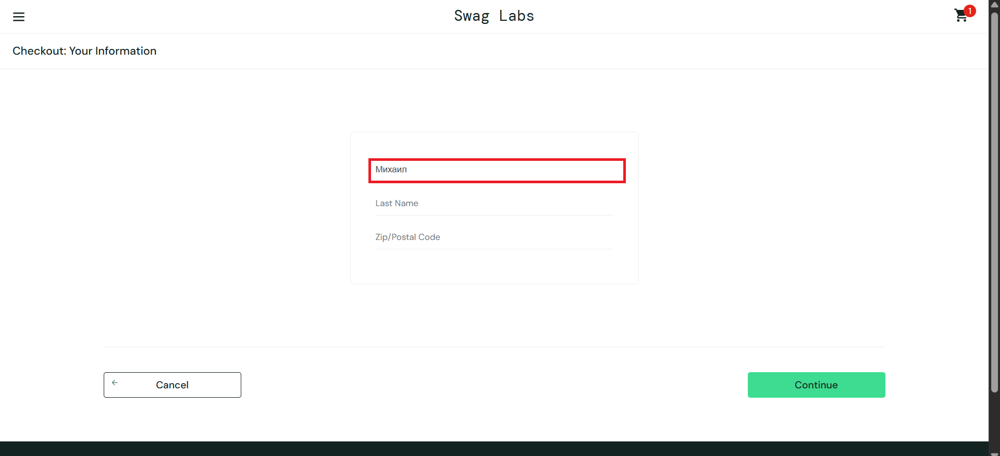
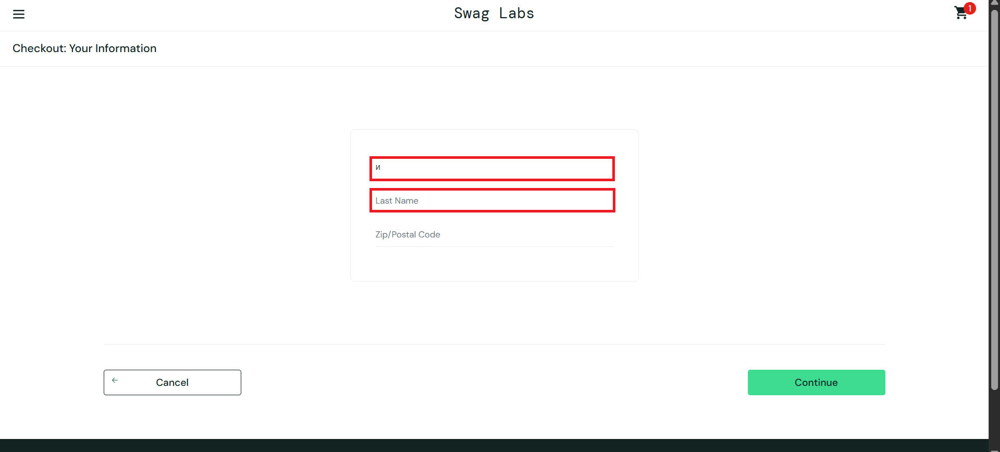

# BUG-04: [Validation] Ввод текста в поле «Last Name» перезаписывает значение поля «First Name» при оформлении заказа

* **Приоритет:** High
* **Серьезность:** Blocker
* **Окружение:** Windows 11, Google Chrome, разрешение 1920x1080

### Предусловия:
* Пользователь авторизирован в системе под учетной записью `problem_user` и находится на странице каталога (`https://www.saucedemo.com/inventory.html`)
* В корзину добавлен хотя бы один товар, пользователь находится на странице оформления заказа (`https://www.saucedemo.com/checkout-step-one.html`)

### Шаги воспроизведения:
1. Ввести корректное имя в поле «First Name», (например, Михаил).
2. Установить курсор в поле «Last Name».
3. Попытаться ввести фамилию (например, Иванов).
4. Обратить внимание на поведение обоих полей ввода («First Name» и «Last Name»).

### Фактический результат:
Поле «Last Name» остается пустым. Каждый вводимый символ попадает в поле «First Name», полностью заменяя собой предыдущее значение в поле «First Name» остается только последняя введенная буква, оформить заказ невозможно.

### Ожидаемый результат:
Вводимый текст отображается в активном поле «Last Name», а значение в поле «First Name» остается без изменений.

### Вложения:

| До (заполнено поле First Name) | После (попытка ввода в поле Last Name) |
| :---: | :---: |
|  |  |