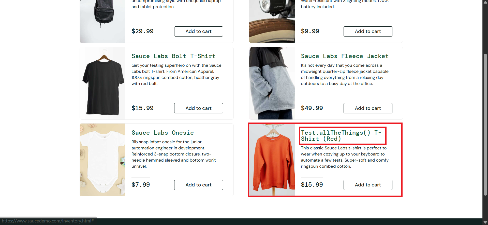

# BUG-05: [Content] Использование технической части кода в названии товара "Test.allTheThings() T-Shirt (Red)"
* **Приоритет:** Low
* **Серьезность:** Minor
* **Окружение:** Windows 11, Google Chrome v120.0

### Предусловия:
* Пользователь авторизирован в системе под учетной записью `standard_user` и находится на странице каталога (`https://www.saucedemo.com/inventory.html`)

### Шаги воспроизведения:
1. Найти в каталоге товаров карточку красной футболки.
2. Прочитать наименование товара в заголовке карточки.
3. Обратить внимание на формат наименования товара.

### Фактический результат:
Название товара содержит системные конструкции с синтаксисом программирования: `Test.allTheThings() T-Shirt (Red)`.

### Ожидаемый результат:
Наименование товара оформлено корректно без использования системных конструкций с синтаксисом программирования.

### Вложения: 

